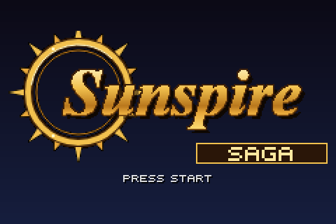
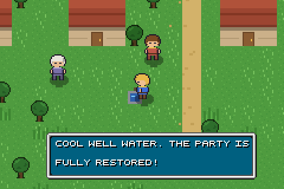
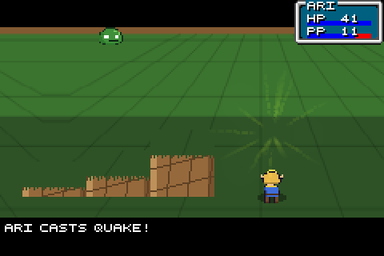

<p align="center">
  
</p>

An original GBA-style pixel-art JRPG for the browser. Four elemental adepts travel from the
village of Thera to the Sunspire, duel and recruit eight spirits, call down the great summons and
face the Shadow Wyrm. It runs in any modern browser, saves as you play, installs as an app and
works offline.

Sunspire Saga is an independent homage: every sprite, tile, name, line of dialog and number is
original, and `ASSETS.md` lists where each asset comes from. The engine is
[goldensun_html5](https://github.com/jjppof/goldensun_html5) (MIT), kept with its licence in
`LICENSE.txt`.

<p align="center">
  
  
  
</p>

## Playing

Play online at [sboulema.github.io/Sunspire-Saga](https://sboulema.github.io/Sunspire-Saga/).

- **Controls:** arrows to move, **Z** = A, **X** = B, **A / S** = L / R, **Enter** = Start,
  **Backspace** = Select, **M** sound, **F** immersive mode. The handheld shell around the screen
  has the same buttons for touch, and its colour and the light / dark theme are remembered.
- **Saving:** the game autosaves on every map change, after battles and at the inns; Start saves
  on demand. *Continue* on the title screen resumes. Saves live in the browser you play in.
- **Installing:** the site is a progressive web app. Browsers that support it show *Install as
  app* under the shell (iOS: *Add to Home Screen* in Safari's share sheet); the installed app
  opens straight into the saved game, full screen, offline.
- **Sprite packs:** every sheet the game draws can be replaced with your own art from the play
  page (*Load sprite pack*). The pack guide page lists every slot; `packs/README.md` has the rules.
- **Walkthrough:** the complete plain-text walkthrough with maps is on the walkthrough page.

## Running it

You need Node 20 or newer (`.nvmrc` says 22) and npm 10 or newer. Run `npm install` once.

### Locally, while developing

```bash
npm start
```

Serves the game on [http://localhost:9000](http://localhost:9000) and rebuilds on every change.
Use a Chromium browser for now. `?debug=1` on the play page shows the engine's debug panels.

### As a static website

```bash
npm run site
```

Builds the whole site into `site/`: the pages, the game bundle, the assets, the manifest and a
service worker that caches everything for offline play. Copy that folder to any static host. The
pages link each other as `.html`, so a plain file host works; `docker/nginx.conf` shows the clean
URLs (`/play`) the Docker image serves. To try it locally with the same clean URLs:

```bash
npm run preview
```

That serves `site/` on [http://localhost:9100](http://localhost:9100). Installing as an app needs
HTTPS or `localhost`, so this is also where to test the install flow. The Publish workflow builds
the same folder on every push to `main` and attaches it as a zip to each `vNN` release. A `vNN`
tag also uploads the folder over FTP to the web host when the repository secrets `FTP_SERVER`,
`FTP_USERNAME` and `FTP_PASSWORD` are set (plus the optional secret `FTP_SERVER_DIR`, the folder
on the server, and the optional repository variable `FTP_PROTOCOL`: `ftp`, `ftps` or
`ftps-legacy`); without them that step is skipped.

### With Docker

```bash
docker build -t sunspire-saga .
```

```bash
docker run --rm -p 8080:80 sunspire-saga
```

The image builds the site with Node and serves it with nginx on port 80; open
[http://localhost:8080](http://localhost:8080). Every push to `main` also publishes the image as
`ghcr.io/sboulema/sunspire-saga:latest` (and `:vNN` for releases), so without building:

```bash
docker run --rm -p 8080:80 ghcr.io/sboulema/sunspire-saga:latest
```

## Changing the game

The game is generated from `assets/sunspire/`: `content.json` holds the characters, arts, gear,
items, shops, chests, spirits, summons, enemies, encounters, maps, villagers, dialog and story,
and `sprites/`, `maps/` and `glyphs.json` hold the source art. After any change there run

```bash
npm run build:content
```

which regenerates the images, the font, the sounds, the databases, the Tiled maps, the pack slot
list and the walkthrough. Edit the sources, never the generated files. `npm run build`
type-checks and bundles the engine, `npm run format` runs Prettier over `base/` (the pre-commit
hook does the same), and `npm run docs` generates the engine's API documentation.

## Credits

- Engine: [goldensun_html5](https://github.com/jjppof/goldensun_html5) by jjppof and contributors, MIT.
- [Phaser CE](https://github.com/photonstorm/phaser-ce), MIT.
- Game, art, data and text: Sunspire Saga.
