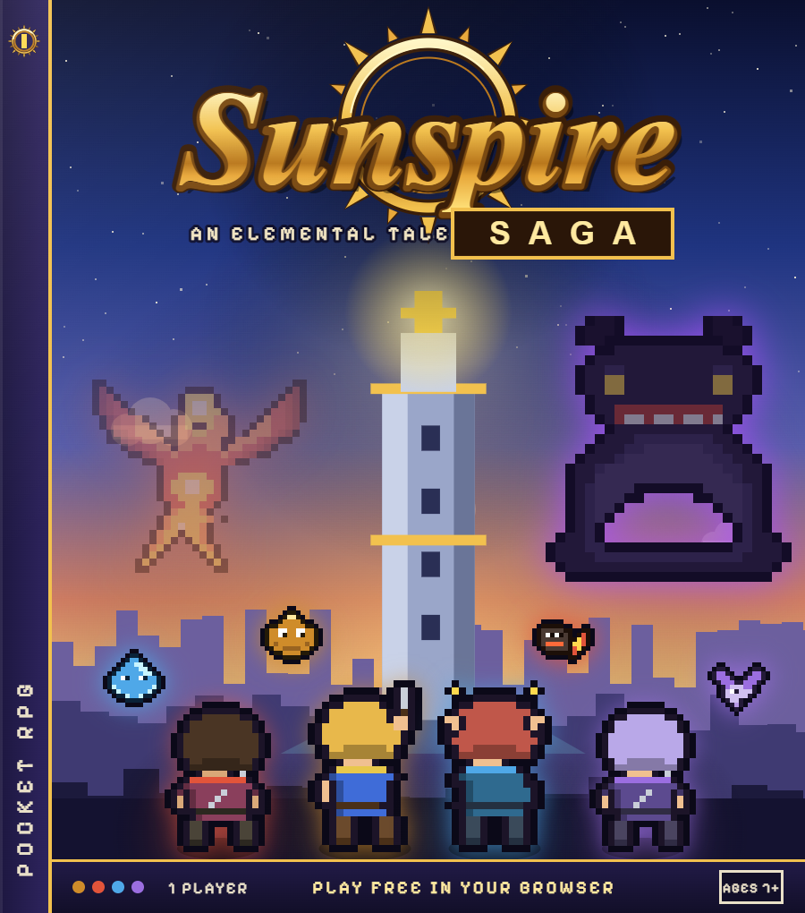

<p align="center"></p>

# Sunspire Saga

An original GBA-style pixel-art JRPG that runs in the browser. Gather eight elemental spirits,
master arts and summons, and bring the dawn back to the Sunspire.

**[Play it here](https://YOUR-GITHUB-USER.github.io/sunspire-saga/play.html)** · no install, no build step, saves in your browser.

<p align="center"></p>

## The site

| Page | What it is |
|---|---|
| `index.html` | landing page: the story, in-game screenshots, concept art and box art |
| `play.html` | the game in its handheld shell, with an immersive (fullscreen) toggle and a *Load sprite pack* button |
| `pack-guide.html` | the sprite pack guide with the complete, generated slot list; packs loaded here are used by the play page |
| `walkthrough.txt` | a classic plain-text FAQ/walkthrough: every area, chest, spirit and boss, with maps and the full bestiary |

Every page has a light / dark toggle (it follows the system until you pick one) and the handheld
shell colour can be changed from the play page or the screenshot viewer; both choices are remembered
in the browser.

## Features

- Four adepts of earth, fire, water and wind, each with their own arts; a party of up to four.
- Eight spirits to duel and recruit; set them for stat bonuses, unleash them in battle, then call the
  great summons – up to the four-element Sol Avatar – with their own cutscenes.
- Overworld with towns, shops, an inn, treasure, a mine, a mountain trail and the Sunspire itself.
- Turn-based battles with an icon toolbar, hidden enemy HP, attack / cast / hit / downed poses, and
  bosses that shrug off plain steel – levelling, arts, spirits and potions all matter.
- **Sprite packs**: every sprite, tile, background and icon can be replaced with your own art, loaded
  locally as PNG/GIF/WebP files or a zip. See [packs/README.md](packs/README.md).
- The whole game is one script, `game.js` (~250 KB), with no dependencies. Hand-pixeled art, 5×5
  bitmap font, WebAudio sound.

## Playing locally

Open `play.html` in a browser. If your browser blocks storage for `file://` pages (saves and
sprite packs use localStorage / IndexedDB), serve the folder instead, for example:

```bash
npx serve .
```

Controls: arrow keys or WASD to move, **Z / Space** = A (confirm), **X / Esc** = B (cancel),
**Enter** = Start / menu, **M** toggles sound, **F** toggles immersive mode. The handheld shell
around the screen has clickable D-pad, A, B and Start buttons for touch play.

## Hosting

The repo is laid out for GitHub Pages: enable Pages for the `main` branch, root folder, and the
site is live at `https://<user>.github.io/sunspire-saga/`. Then replace `YOUR-GITHUB-USER` in the
social-card URLs in the `<head>` of `index.html` and `play.html` (and in this README) so link
previews show `assets/sunspire-card.png`. Alternatively copy the three HTML files, `game.js` and
`assets/` to any static host. A workflow for Pages deployment via Actions is included in
`.github/workflows/pages.yml` if you prefer that over branch deployment.

## Repository layout

| Path | What it is |
|---|---|
| `game.js` | the whole game – source and distribution in one file |
| `index.html`, `play.html`, `pack-guide.html`, `changelog.html` | the site: landing page, play page, pack guide, changelog |
| `walkthrough.txt` | the walkthrough; it mirrors the data in `game.js` and must be updated with every game change (see `CLAUDE.md`) |
| `assets/` | logo, social card, favicon, site CSS/JS, `screens/` (in-game screenshots) and `art/` (box art, concept sheets) |
| `packs/` | how to make and share sprite packs |
| `tools/` | generators for the logo, card, favicon, screenshots and promotional art |

Releases are tagged (`v34`, …); `changelog.html` is the authoritative change list, and the title
screen shows the running version.

## Credits and licence

Code and art are original work, released under the [MIT licence](LICENSE). Sunspire Saga is an
independent homage to the handheld JRPGs of the early 2000s; it is not affiliated with or endorsed
by Nintendo or Camelot and contains no assets from their games.
